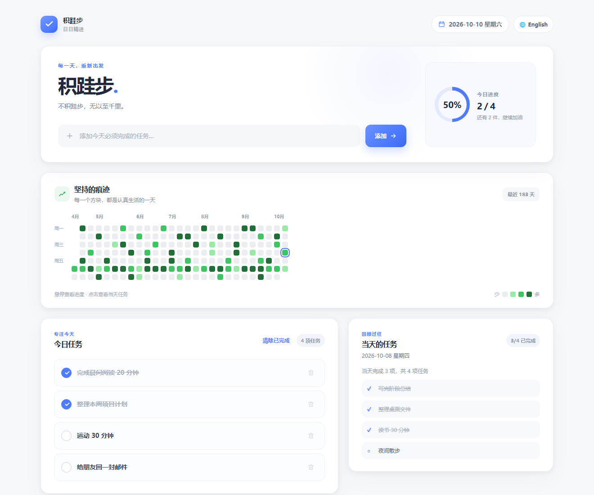
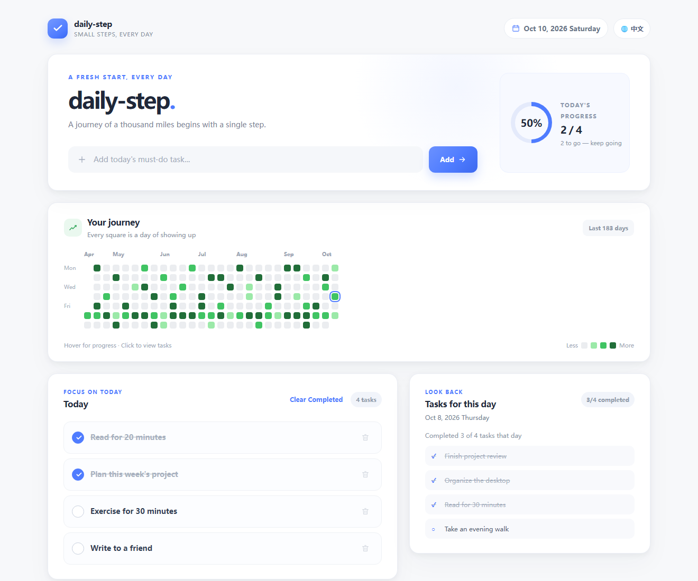

# 积跬步 · daily-step

**不积跬步，无以至千里。**

一款离线可用的每日任务打卡应用，用简洁的任务列表和热力图记录每一步。

[下载 Windows 版](https://github.com/cs-sdran/daily-step/releases/latest) · [从源码运行](#从源码运行) · [English](#english)

本地优先 · 无账号 · 无后端 · 中英文界面

## 界面预览

查看 English 界面

 

截图使用演示任务，不包含真实用户数据。

## 功能

| | |
| --- | --- |
| **今日任务** | 添加、完成、取消完成和删除任务，进度即时更新。 |
| **历史回顾** | 点击热力图中的日期，查看当天任务及完成情况。 |
| **打卡热力图** | 用最近 183 天的颜色方块回看自己的进展。 |
| **中英切换** | 自动识别浏览器语言，也可随时手动切换并记住选择。 |
| **离线保存** | 数据留在本机，无需注册账号、连接服务器或使用数据库。 |

## 快速开始

### 下载 Windows 桌面版

前往 [最新 Release](https://github.com/cs-sdran/daily-step/releases/latest)，下载 **daily-step-Windows.exe** 后双击打开。可以把文件放到桌面，或为它创建桌面快捷方式。

### 直接在浏览器中使用

下载本仓库后，双击 [src/index.html](src/index.html) 即可。浏览器版与桌面版使用各自独立的本地存储。

## 从源码运行

需要 **Python 3.10+**。桌面窗口由 pywebview 提供；界面采用原生 HTML、CSS 与 JavaScript。

**Windows（PowerShell）**

~~~powershell
py -3 -m venv .venv
.\.venv\Scripts\python.exe -m pip install -r requirements.txt
.\.venv\Scripts\python.exe src\main.py
~~~

**macOS**

~~~bash
python3 -m venv .venv
.venv/bin/python -m pip install -r requirements.txt
.venv/bin/python src/main.py
~~~

## 自行打包

打包脚本会自动创建虚拟环境、安装依赖并运行 PyInstaller。首次安装依赖需要联网；生成的应用可离线运行。

| 平台 | 命令 | 输出 |
| --- | --- | --- |
| Windows | <code>build_scripts\build_windows.bat</code> | <code>dist\积跬步.exe</code> |
| macOS | <code>bash build_scripts/build_macos.sh</code> | <code>dist/积跬步.app</code> |

请在对应操作系统上打包。当前 Release 提供 Windows 可执行文件；macOS 用户可按上面的脚本从源码构建。

## 数据与隐私

任务按本地日期保存，键名为 <code>tasks_YYYY-MM-DD</code>；语言偏好保存为 <code>app_lang</code>。当前版本使用 **localStorage**，不生成 <code>tasks.json</code>。

桌面版的 WebView 数据目录：

- Windows：<code>%USERPROFILE%\.small_steps\webview</code>
- macOS：<code>~/.small_steps/webview</code>

浏览器直接打开 HTML 时，任务保存在该浏览器自己的站点存储中，与桌面版不共享。卸载或清理浏览器数据前，请留意其中的任务记录。

## 项目结构

~~~text
积跬步/
├── src/
│   ├── index.html          # 页面、样式与交互
│   ├── main.py             # pywebview 桌面启动器
│   └── app.ico             # Windows 图标
├── docs/screenshots/       # README 界面截图
├── build_scripts/
│   ├── build_windows.bat
│   └── build_macos.sh
├── requirements.txt
├── .gitignore
├── LICENSE
└── README.md
~~~

## English

**daily-step** is an offline daily task tracker with a clean interface, read-only history, and a 183-day contribution heatmap. Switch between Chinese and English from the top-right button; the app remembers your preference.

- **Windows:** download [the latest release](https://github.com/cs-sdran/daily-step/releases/latest) and open **daily-step-Windows.exe**.
- **Browser:** download the repository and open [src/index.html](src/index.html).
- **Source:** install Python 3.10+, then follow [the commands above](#从源码运行).
- **macOS:** build from source with <code>bash build_scripts/build_macos.sh</code>.
- **Data:** tasks stay in localStorage on your device. Browser and desktop storage are separate.

## License

Released under the [MIT License](LICENSE). Issues and pull requests are welcome.
